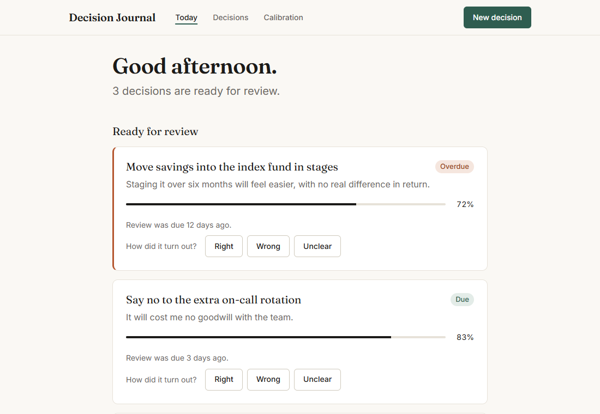
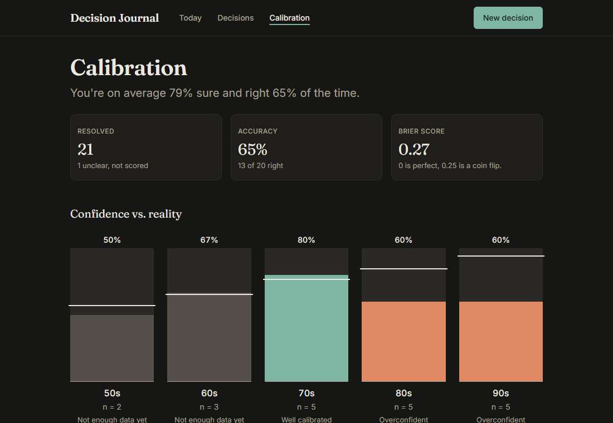

<h1 align="center">Decision Journal</h1>

<p align="center">
  <strong>Log your decisions. Say how sure you are. Find out if you were right to be.</strong>
</p>

<p align="center">
  <a href="https://nodejs.org" title="Node.js"></a>&nbsp;
  <a href="https://expressjs.com" title="Express"></a>&nbsp;
  <a href="https://pugjs.org" title="Pug"></a>&nbsp;
  <a href="https://www.sqlite.org" title="SQLite"></a>&nbsp;
  <a href="https://developer.mozilla.org/docs/Web/CSS" title="CSS"></a>
</p>

<p align="center">
  Node.js · Express · Pug · SQLite · hand-written CSS
</p>

<table>
  <tr>
    <td></td>
    <td></td>
  </tr>
</table>

A small, server-rendered web app for one person, running on their own machine. You write down a decision when you make it, come back on its review date, and over time see whether "80% sure" really means you're right 80% of the time.

## Features

- **Fast capture:** what you decided, what you expect, how confident you are (50–99%) and when to check back
- **Reviews that come back to you:** due decisions wait on the dashboard and resolve in one click
- **A calibration report:** hit rate per confidence level, Brier score, and whether you're over- or underconfident
- **Filters you can bookmark:** status, tag, text search, sorting and pagination all live in the URL
- **No JavaScript needed:** everything works with plain HTML forms; a small optional script adds conveniences
- **Light and dark themes:** follows your system setting and works from 360px wide upwards

## Getting started

Requires Node.js 20 or newer.

```sh
npm install
npm run seed    # optional: adds demo data
npm start       # http://localhost:3000
```

## Scripts

| Command | What it does |
|---|---|
| `npm start` | Runs the app |
| `npm run dev` | Runs the app and restarts it when files change |
| `npm run seed` | Adds demo data to an empty journal; does nothing if the journal has data |
| `npm run reset` | **Deletes every decision**, then adds the demo data |
| `npm test` | Runs the tests |

## Configuration

| Variable | Default | Purpose |
|---|---|---|
| `PORT` | `3000` | Port to listen on |
| `DB_PATH` | `./data/journal.db` | SQLite database file, created on first run |
| `SESSION_SECRET` | a development value, with a console warning | Signs the session cookie |

## Security

The app has no login and is meant to run locally, so it only listens on `127.0.0.1`.

Every form that changes data carries a CSRF token tied to your session, so another website can't submit forms here on your behalf. A request with a missing or wrong token gets a 403 and changes nothing.

Sessions are kept in memory, so restarting the server invalidates forms that are already open. Reload the page before submitting one.

## How it's organised

```
src/
  server.js        app setup, middleware, error handlers
  db/              connection, migrations, seed data
  repositories/    all the SQL
  services/        calibration maths (pure functions)
  routes/          dashboard, decisions, calibration
  validation/      form validation, returns { values, errors }
  lib/             dates, flash messages, CSRF protection
views/             Pug templates, mixins and partials
public/            one CSS file, the favicon, optional enhance.js
test/              node --test suites
```

To change the schema, add a numbered file such as `002_add_field.sql` to `src/db/migrations/`. It runs on the next start, inside a transaction.

The full design is in [SPEC.md](SPEC.md).
